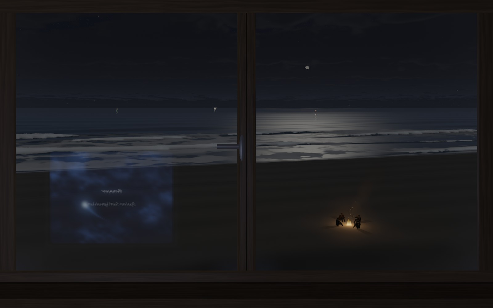
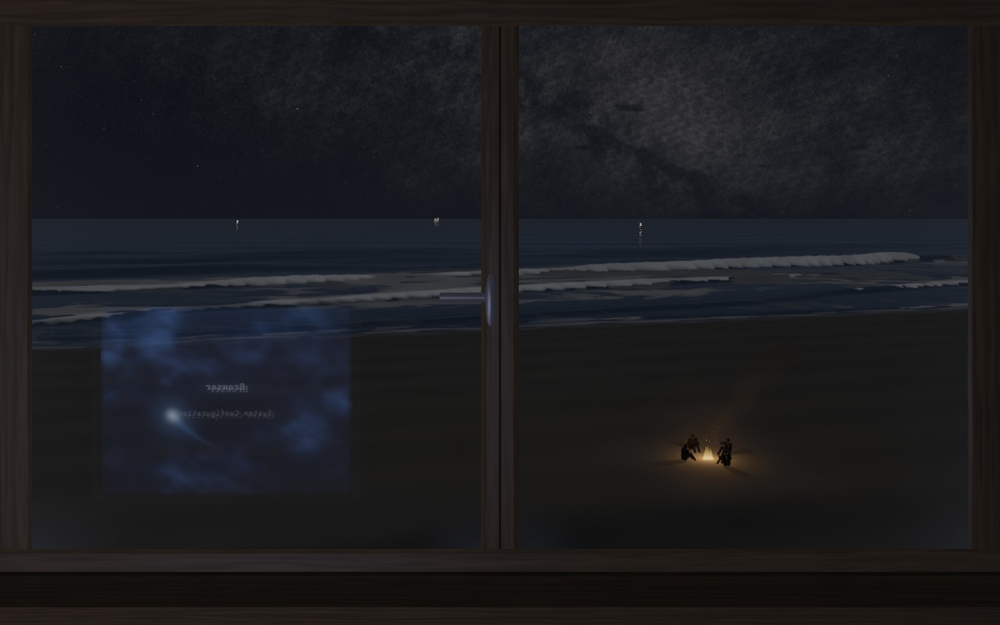

# Pacífico de Pellines



Pacífico de Pellines es el mar de la playa de Pellines, en la costa del Maule, visto por la ventana de una cabaña que está sobre una laja, a unos 15 metros sobre el agua y a 110 metros de la orilla. No es un video ni una animación que se repite: cada ola se calcula en vivo sobre un pedazo de mar de 800 por 340 metros, revienta donde la física dice que revienta, y el sonido sale de la energía que esas olas pierden al romper, así que lo que se escucha y lo que se ve son la misma cosa. La marea es la de Constitución según el SHOA, la luna y el sol están donde de verdad están esa noche sobre Pellines, y la marejada se sortea cada noche con el clima de olas del Atlas de Oleaje de Chile. Es el mar de verdad, calculado.

La idea es que sea como estar en la cabaña, con la Play prendida en el menú de inicio, mirando la playa de noche mientras alguien hace una fogata abajo en la arena. Por eso la vista no es inventada: medimos la cabaña en la imagen satelital (la arena seca empieza a 38 metros, la mojada a 103 y la espuma a 124), sacamos la altura de la laja del modelo de terreno Copernicus GLO-30 y orientamos la ventana a 311 grados, que es hacia donde mira la pared de verdad. Esa ventana queda girada 17 grados respecto de la costa, y por eso la orilla se ve más cerca a la izquierda y se aleja hacia la derecha. Lo único que no copiamos de la foto es el matorral que hoy crece al pie del barranco, porque en el recuerdo ahí era todo arena. Además, el programa usa a propósito todos los hilos del procesador y la tarjeta gráfica, para que en invierno el computador entibie la pieza mientras suena el mar.



## Cómo usarlo

Hay que bajar `PacificoDePellines.exe` desde [Releases](https://github.com/franciscoaldun/pacifico-de-pellines/releases) y abrirlo; no necesita instalación. Por ahora es solo para Windows 10 y 11 de 64 bits, con un procesador que tenga AVX2 (Intel desde 2013, AMD desde 2015). Si hay tarjeta gráfica con DirectX 11 la usa para las nubes, el cielo, el reflejo de la tele y la ventana, y si no, dibuja todo con el procesador. Como el ejecutable no está firmado, Windows puede mostrar el aviso de SmartScreen la primera vez; se abre con «Más información» y «Ejecutar de todas formas».

Se maneja con el teclado. Las flechas arriba y abajo suben y bajan el volumen, las de los lados el brillo, la V entreabre o cierra la ventana y cambia cómo se escucha el mar a través del vidrio, la R pasa la lluvia por sus tres modos (va y viene, apagada o siempre), la P prende o apaga la Play, la F pone o saca el marco, la M abre el panel con la curva de la marea del SHOA, la L pone la luna en la ventana con la fase de hoy, la G pone el centro de la Vía Láctea saliendo sobre el mar, y Esc cierra. A las 8 horas se despide sola con un minuto de fundido, para no quedar sonando toda la noche; con `--s` y un número de segundos se cambia ese límite, `--mudo` la abre sin sonido, `--marea` la abre con el panel de la marea y `--ventana` la abre en una ventana de 1280 por 800 en vez de pantalla completa.

## Cómo funciona

El mar es una grilla de 640 por 272 celdas de 1,25 metros donde se resuelven las ecuaciones de Boussinesq y de aguas someras, con barras y canales de resaca en el fondo, repartida entre todos los hilos del procesador. La marejada de cada noche sale del nodo 9 del Atlas de Oleaje de Chile, frente a Constitución, que da olas de 2,28 metros de altura significativa (2,38 en invierno) y 13,2 segundos de período. La marea se calcula con 36 constantes armónicas ajustadas a la tabla oficial del SHOA para Constitución, con un minuto y 0,6 centímetros de error, y el programa renueva solo esa tabla desde shoa.cl. El sonido no usa ninguna grabación: se sintetiza desde la energía que disipa cada ola al reventar, con el retardo de su distancia real hasta la ventana, más el viento y la lluvia gota a gota sobre el techo de zinc.

La imagen se calcula rayo por rayo en el procesador. Cada columna de la pantalla baja por la arena, cruza la playa y recorre el mar simulado hasta el horizonte, y el color sale de la física: el agua refleja el cielo y la luna según su inclinación real, la espuma viaja pegada al agua y la arena brilla donde el agua la mojó. La tarjeta gráfica agrega las nubes en volumen, las estrellas y la Vía Láctea en su lugar a esa hora, la luna con su fase, el reflejo de la tele en el vidrio y la ventana de madera. La luna y el sol siguen el método de Paul Schlyter, que comparado con las efemérides JPL DE421 coincide dentro de un grado. Abajo en la arena, a 42 metros, hay una fogata con cuatro personas que respiran, conversan, se pasan el mate y atizan el fuego, y el fuego las alumbra de su lado y les tira la sombra sobre la arena.

Todo está escrito en C, sin más bibliotecas que las de Windows.

## Compilar

Se compila con MinGW-w64 desde Linux, WSL o MSYS2:

```sh
sh compilar.sh
```

El script arma el ícono con `windres` y compila `src/pacifico.c`, que incluye todos los demás archivos. La letra de los textos en pantalla se regenera con `herramientas/gen_fuente.py`.

## Créditos y licencia

Desarrollado por Francisco Aldunate.

Es libre: se puede usar, copiar, modificar y compartir, también con fines comerciales, siempre que se mantenga el crédito y el aviso de la licencia MIT que está en [LICENSE](LICENSE).

Los datos de marea son del Servicio Hidrográfico y Oceanográfico de la Armada de Chile (SHOA) y el clima de olas, del Atlas de Oleaje de Chile de la Universidad de Valparaíso. La altura de la laja salió de Copernicus WorldDEM-30 © DLR e.V. 2010-2014 y © Airbus Defence and Space GmbH 2014-2018, provisto bajo COPERNICUS por la Unión Europea y la ESA. Las posiciones de la luna y el sol siguen el método de Paul Schlyter, y la letra de los textos en pantalla viene de Cascadia Mono, de Microsoft, con licencia SIL Open Font License 1.1. El menú de la PlayStation 2 que se refleja en el vidrio es un homenaje: PlayStation es una marca registrada de Sony Interactive Entertainment, este proyecto no tiene relación con Sony y no usa ningún archivo ni sonido de la consola.

## In English

Pacífico de Pellines is the sea of Pellines beach, on the Maule coast of Chile, seen through the window of a cabin on a rock ledge 15 m above the water and 110 m from the shore. Every wave is simulated live with the Boussinesq and shallow-water equations on an 800 × 340 m patch of sea, and the sound is synthesized from the energy the waves lose when they break, so what you hear and what you see are the same thing. The tide follows the official SHOA tables for Constitución, the moon and the sun are where they really are tonight, and the view was measured from satellite imagery and the Copernicus DEM. Written in C for Windows, MIT licensed.
